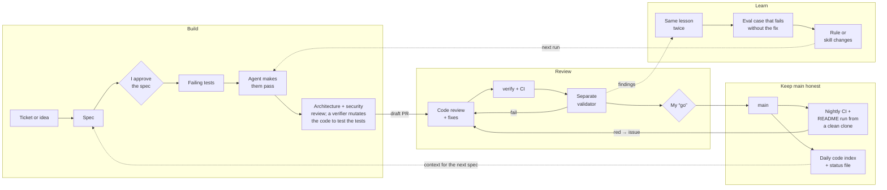

# Hlib Havryliuk

**Product manager, AI builder and pipeline engineer.**

I decide what an AI pipeline should do, then build the runtime that does exactly that. Nine years in product across fintech, mobility and SaaS. Based in Berlin.

---

### What I'm building now

**LeanOS** *(private)* — a memory of a studio's best decisions that another artist can pick up. How the studio solved a hard shot, with which tools and settings, and what the founder rejected along the way. Someone else applies it to a new scene, and the founder only approves. Founders' hours stop capping how many projects a studio can run.

Proven so far: an engineer who didn't build the system re-ran three recorded methods on their own accounts, 34 of 36 shots. In a blind gate I accepted 88% of their clips vs 83% of my own and guessed authorship 49% of the time. Methods move across four vendors (ComfyUI, Magnific, Higgsfield, Runway) with a human gate at every seam. 

Next: transfer to scenes the author never made. **I'm looking for AI artists to join as creative partners:** you bring a method, it stays yours, and we test whether someone else can carry it to new scenes. Python, FastAPI, Postgres, Pydantic, pytest, strict mypy.

---

### Systems I've shipped in the open

**[higgs-agent-factory](https://github.com/HlibHav/higgs-agent-factory)** — Built in one day at the Boson AI hackathon in Toronto (2026-10-24). Turns a one-line brief into a voice agent on Boson's Higgs Realtime API, then refuses to release it until it passes an eval gate: scripted callers over real audio, an LLM judge grading every answer twice, latency and barge-in measured client-side. A coach rewrites only the skills that failed; on a live run one round took an agent from 4 of 6 scenarios to 6 of 6. Python + TypeScript + Higgs Realtime + Claude.

**[dev-digest-ai-marketplace](https://github.com/HlibHav/dev-digest-ai-marketplace)** — Claude Code plugin marketplace for spec-driven development, extracted from my DevDigest harness and generalised for any repo. Four plugins: a shared done gate, a read-only researcher, an architecture reviewer, and an idea → spec → plan workflow that ties them together. Versioned releases with dependency ranges and a written threat model.

**[AI-interview-](https://github.com/HlibHav/AI-interview-)** — Multi-agent system that runs qualitative interviews end to end: goal clarification, script planning, live conversation, synthesis. Real-time sentiment and dynamic follow-up generation. Next.js + LangChain + Weaviate.

**[AI-webbrowser](https://github.com/HlibHav/AI-webbrowser)** — Agentic research browser. Multi-pass RAG with three-stage reasoning and confidence scoring, unified vector (Weaviate) + full-text (Typesense) retrieval, local model support via Apple OpenELM (270M–3B). React + Node + Phoenix/OpenTelemetry.

**[Carelink](https://github.com/HlibHav/Carelink)** — Elderly-support platform: dialogue, coach and safety agents on event-driven microservices with Weaviate-backed memory.

**[MMS](https://github.com/HlibHav/MMS)** — Six-agent retail campaign co-pilot built in a 14-hour hackathon: briefing, baseline forecast, scenario lab, optimisation, creative, post-mortem. LangChain + FastAPI + DuckDB.

Earlier data work

**[CitiBike Analytics](https://github.com/HlibHav/New-York-s-CitiBike-trips-in-2025)** — 1M+ trips, weather correlation 0.768, geospatial filtering in Streamlit.

**[Taxi Fraud Detection](https://github.com/HlibHav/Taxi)** — 0.94 ROC AUC on 200K+ transactions; clustering plus geographic risk patterns.

---

### How I work

Product side first: discovery with studios and deciding what is worth building at all. Every bet becomes a hypothesis with a threshold set before the test and a pivot condition written before the result. Only what survives that becomes a spec.

Then I build with agents in four loops. Agents do the typing; three calls stay mine: approving the spec, answering when an agent escalates, and saying "go" on a merge.

One line holds across all of it: a system should refuse rather than lie. If a step didn't run, the record says so.

🌐 [hlib.work](https://hlib.work) · [LinkedIn](https://linkedin.com/in/glebaz) · glib.gavryliuk@gmail.com
